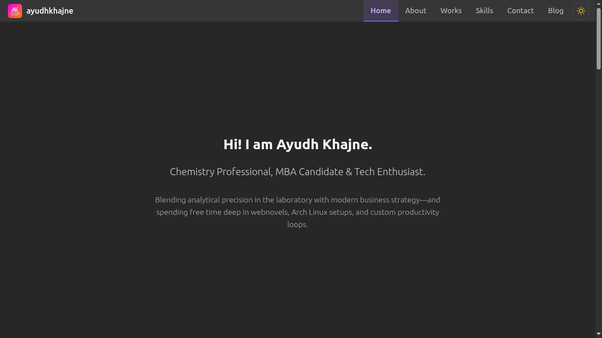
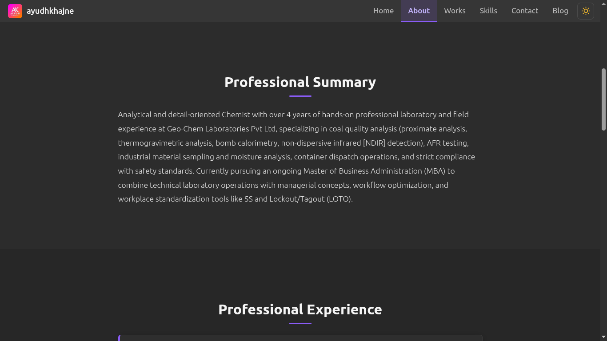
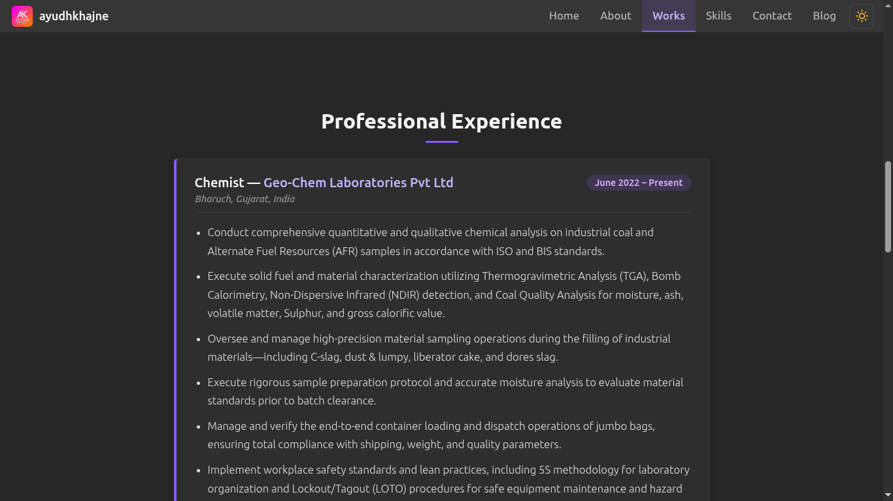
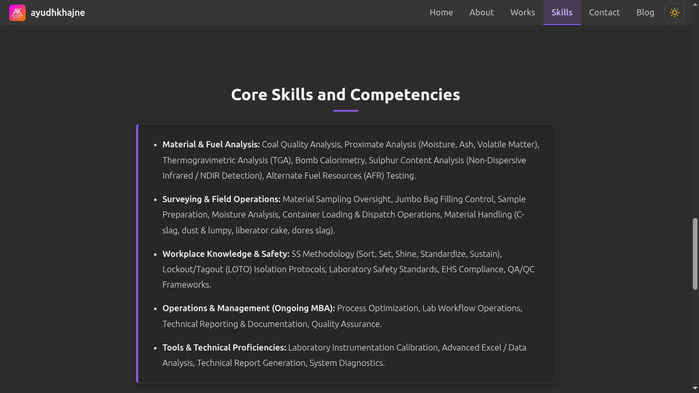
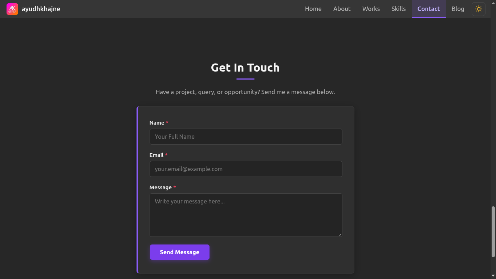
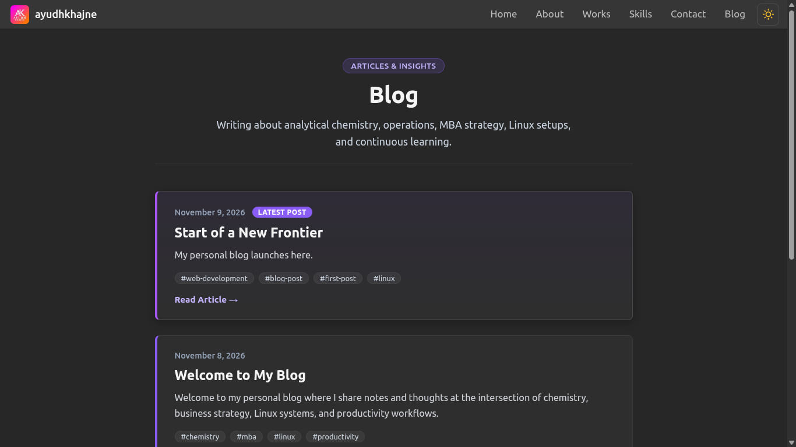

So I can suppose that my website is fully functional (just does not have a personal domain name yet). I completed building the Blog section of the website yesterday using Antigravity IDE. And with the use of AI (Gemini), building it has been a breeze.

Let's talk about my website. It is currently hosted on GitHub and it is quite minimal. Here is a screenshot of the **homepage**.

It looks good. Doesn't it?

The home page consists of the following sections:
- A navbar at the top: It shows all the branding, links to different sections of the page and a toggle for light mode.
- Then comes the 'Home' section: It shows a few line about me.
- Next is 'About', 'Works', 'Skills' and 'Contact' sections and their purpose is evident by their names.
- At the bottom is the footer which has links for my social media profiles.

Here are the screenshots for all the sections:

**About section**

**Works section**

**Skills section**

**Contact section**

And then there is '**Blog**' which is in a separate page. It is the newest addition.

Hope you like this.

Stay tuned for more updates.